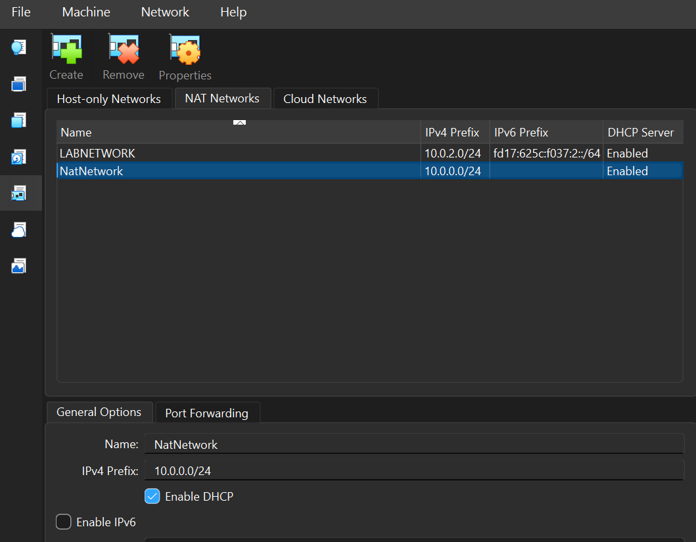
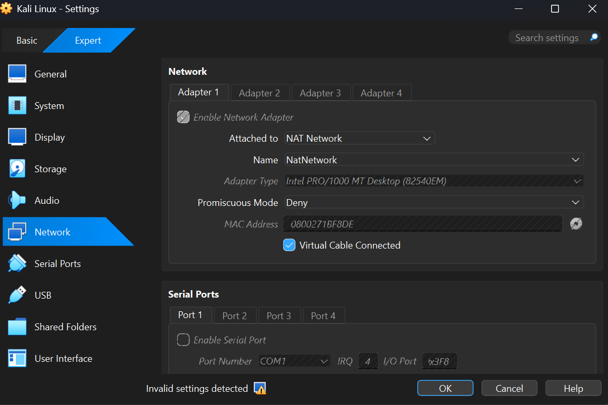

# Cybersecurity Testing Lab Setup: Kali Linux on VirtualBox

An isolated virtual penetration-testing lab built with Oracle VirtualBox
and Kali Linux on a custom NAT Network with a static IP.

## Objectives
- Build an isolated lab network separate from existing VMs
- Deploy Kali Linux with a static IP (10.0.0.2/24)
- Enable internet access, shared folders, clipboard and drag-and-drop
- Create a baseline snapshot for recovery

## Architecture
| Component | Value |
|---|---|
| Hypervisor | Oracle VirtualBox 7.x (Host: Windows 10) |
| Guest OS | Kali Linux <version> |
| Network | NAT Network `NatNetwork` |
| Subnet | 10.0.0.0/24 |
| Gateway | 10.0.0.1 |
| Kali IP | 10.0.0.2/24 (static) |

Existing VMs (Metasploitable2, etc.) remain on the separate
`LABNETWORK` (10.0.2.0/24) and were not affected.

## Setup Steps
1. **Create the NAT Network** (File → Tools → Network Manager)
   
2. **Attach Kali's Adapter 1** to the NAT Network
   
3. **Configure the static IP** 
4. **Set up the shared folder** with Auto-mount
5. **Take a baseline snapshot**

## Verification
| Test | Command | Result |
|---|---|---|
| Interface | `ip a` | eth0 UP, 10.0.0.2/24 |
| Gateway | `ping -c 3 10.0.0.1` | 0% loss |
| Internet | `ping -c 3 8.8.8.8` | 0% loss |
| DNS | `ping -c 3 google.com` | Resolves |

(embed screenshots 03–08 here)

## Troubleshooting: NetworkManager IP Reservation Timeout
**Problem:** `nmcli` failed with "IP configuration could not be reserved",
yet `ip addr add` worked.
**Likely cause:** Duplicate Address Detection conflicting with
VirtualBox's NAT engine reservations.
**Fix:** Disable DAD on the profile: `nmcli connection modify "Kali-Lab" ipv4.dad-timeout 0`

## Lessons Learned
- How VirtualBox NAT Networks differ from NAT and Bridged modes
- How NetworkManager handles static addressing and DAD
- Why snapshots matter before security testing

## Disclaimer
For educational use in an isolated lab only. Only test systems you own
or have written permission to test.

## Author
Raphael Ndidi-Uboma · [https://www.linkedin.com/in/raphael-ndidi-uboma](#) · Network Walks 2026 Cybersecurity Internship, Week 1
